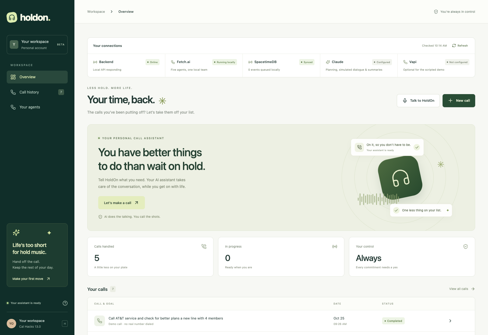

# HoldOn

An AI assistant for the phone calls you keep putting off. Built in stages from the supplied system architecture.



## Share a public demo

[](https://render.com/deploy?repo=https://github.com/Ramreddy2748/Calhacks-project)

Create a Render account, click the button, and review the **Free** web service before deploying. Render provides an HTTPS link after deployment. See [the public demo guide](integrations/public-demo.md) for enabling Claude and verifying visitor isolation. No public deployment is created by committing this configuration.

The public demo gives each visitor a signed browser session and separate task history. Real calls, SMS, and provider webhooks are disabled. Without API credentials it runs the offline simulation; add Claude credentials in Render's environment settings for AI-generated conversations. Free hosting sleeps when idle and **history and usage counters can reset on restarts/redeploys**. This is a temporary demonstration, not durable user accounts or production hosting.

## Run locally

For real outbound phone calls using **ElevenLabs + a SIP carrier**, see
[the phone setup guide](integrations/elevenlabs-phone.md). Vapi is not required
for this path. The public demo stays simulation-only; use a protected workspace
with an approved destination and available carrier funds. The adapter is tested
with mocked provider responses; no real call has been verified yet.

Use Node 22.14+ (required by the Vapi Web SDK) and Python 3.11+. From this directory:

```sh
python3 -m venv .venv
.venv/bin/pip install -r backend/requirements.txt
cp backend/.env.example backend/.env
.venv/bin/uvicorn app.main:app --app-dir backend --host 127.0.0.1 --port 8000
```

In another terminal:

```sh
cd frontend
npm ci --legacy-peer-deps
npm run dev
```

Open **http://127.0.0.1:5173**. API documentation: **http://127.0.0.1:8000/docs**.


## Build sequence

1. **Dashboard — implemented.** React + Tailwind CSS, responsive overview, goal/context form, call history, live transcript, agent activity, approval controls, summary and JSON export. A call-stage workflow shows recorded progress through the four roles, including holds, approval decisions, and stopped sessions. The connection panel checks backend and Fetch.ai runtime readiness, distinguishes configured Claude/Vapi credentials from verified provider access, and clears stale readiness after failed health checks.
2. **Backend — implemented.** FastAPI, validated task creation, SQLite persistence, replayable server-sent events, cancellation and restart recovery. All timestamps persist in UTC and display in the browser's locale.
3. **Fetch.ai orchestration — implemented locally.** Five real uAgents (Orchestrator, Planner, Negotiator, Guardrail, Reporter) exchange typed request/result messages through the SDK’s local dispatcher. Each request has a unique correlation ID, expected sender, task ID, timeout, and cancellation cleanup. Guardrail creates approval requests and checks the exact user-approved record; it cannot approve actions itself. The deterministic demo covers the entire loop. Claude planning, simulated negotiation, and reporting use `ANTHROPIC_API_KEY` plus an explicitly selected `ANTHROPIC_MODEL`. Without those settings, the demo stays deterministic.
4. **Voice — browser integration and phone adapter implemented; provider setup needed.** Browser mode includes microphone permission handling, start/end and mute controls, Vapi SDK captions, persistent final transcripts, authenticated backend approval tools, and end-of-session reporting. No telephone number or private Vapi API key is required for browser mode. See [browser voice setup](integrations/vapi-browser.md). Real Vapi audio still needs account credentials and has not been verified in this environment. The legacy phone adapter includes Vapi outbound calls, authenticated transcript/status webhooks, a synchronous approval tool, and end-of-call reporting. See [live setup](integrations/vapi-assistant.md). An imported Twilio number and Vapi-configured Deepgram/ElevenLabs can supply the lower voice loop from the diagram. No real call has been made or verified as part of this build.
5. **SpacetimeDB — event mirror implemented.** A private module stores ordered task events and latest snapshots. The backend drains its durable SQLite outbox with retry and persistent checkpoints. Dashboard updates still use SSE; SQLite remains the recovery store. See [SpacetimeDB setup](integrations/spacetime.md).
6. **Summary SMS — adapter and explicit-send UI implemented.** Preview and confirm each message, inspect provider status, and block duplicate/ambiguous retries. Twilio credentials, a sender, a recipient, and credits are still needed; no real text has been sent. See [SMS setup](integrations/sms.md).
7. **Public Agentverse — standalone planner and registration command implemented.** The ACP planner returns suggestions without private account access or paid calls. Account credentials and a public endpoint are still needed to register and verify it. See [Agentverse setup](integrations/agentverse.md).
8. **Deployment — Docker packaging and hosted workspace gate implemented.** The image serves the dashboard and API together, with secure sign-in cookies and persistent storage. Cloud account, HTTPS origin, and public deployment remain outstanding. See [deployment setup](integrations/deployment.md).

Live replies still run in Vapi; the local Negotiator generates Claude-powered simulation proposals when configured. Fetch.ai routes planning, approval checks, and reporting. The ElevenLabs SIP phone adapter requires an agent, a carrier-backed number, approval webhooks, and carrier funds. The legacy Vapi phone adapter is opt-in with `PHONE_PROVIDER=vapi`.

## Layout

```text
frontend/src/          React dashboard and responsive styles
backend/app/main.py    API, demo and Vapi adapter
backend/app/orchestration.py  Fetch.ai message routing and runtime lifecycle
backend/app/agents.py  Planner/reporter Claude adapter and approval records
frontend/src/browserVoice.mjs  Vapi SDK lifecycle and ordered browser events
frontend/src/BrowserCallPanel.jsx  Browser microphone and call controls
backend/app/store.py   Persistent snapshots and ordered event history
backend/tests/         Lifecycle, approval and persistence tests
integrations/          Provider setup instructions
```

## Verify

```sh
cd frontend
npm run build
node --test tests/*.test.mjs
cd ..
PYTHONPATH=backend .venv/bin/pytest backend/tests -q
```

This is a single-workspace MVP with no multi-user tenancy, durable call-execution queue, or guaranteed automatic hangup. Local mode binds to loopback. Hosted mode must enable the workspace access gate and HTTPS. Use one API worker and keep `.env` out of version control. Vapi reaches only the secret-authenticated webhook; task and approval APIs stay protected. Never enter passwords, payment credentials, or other sensitive account information. Live calls are blocked unless the number is on the server allowlist and the user explicitly confirms that the teammate expects the call.

## Fetch.ai orchestration

Install the updated backend requirements and restart the backend with the usual command.
No extra process, API key, or port is required. Create a demo call and approve or decline
the proposal to exercise the full agent flow. The Your agents screen reports the running
integration; `GET /api/health` includes runtime readiness and the five local agent addresses.
Addresses are ephemeral per backend startup. Run one API worker.

The runtime uses uAgents 0.23.6 `Agent.setup()` and `Context.send()` with local
dispatcher transport. It owns only the SDK tasks it creates, unregisters its local
sinks on shutdown, and never starts a uAgents HTTP server or network registration.
The SDK and core versions are pinned because scoped cleanup depends on the dispatcher API. A synchronous constructor adapter suppresses the SDK’s otherwise automatic ledger-version lookup; local startup requires no ledger access.
Role errors and timeouts fail the task rather than silently falling back to a different
orchestrator. Calls are never retried automatically.

References: [uAgents Bureau and local communication](https://uagents.fetch.ai/docs/guides/bureau),
[uAgents source](https://github.com/fetchai/uAgents).

### Claude-powered simulation

With `ANTHROPIC_API_KEY` and `ANTHROPIC_MODEL` configured in `backend/.env`, new demo tasks use Claude through the Fetch.ai Planner, Negotiator, and Reporter. Dialogue and proposed terms reflect the goal and context. The backend still requires an exact user approval before emitting the simulated outcome. All demo results are explicitly hypothetical; no number is dialed or account changed. Without Claude configuration, the deterministic offline demo remains available. Existing tasks retain their recorded engine and transcript.

In Claude simulations, declining rejects only the current proposal. The Negotiator receives the transcript and decision history and explores another option, with a fresh approval ID. The simulation stops after three rejected proposals, five minutes of inactivity, approval of a proposal, or an explicit End demo action. Previous approvals cannot authorize a new proposal.
